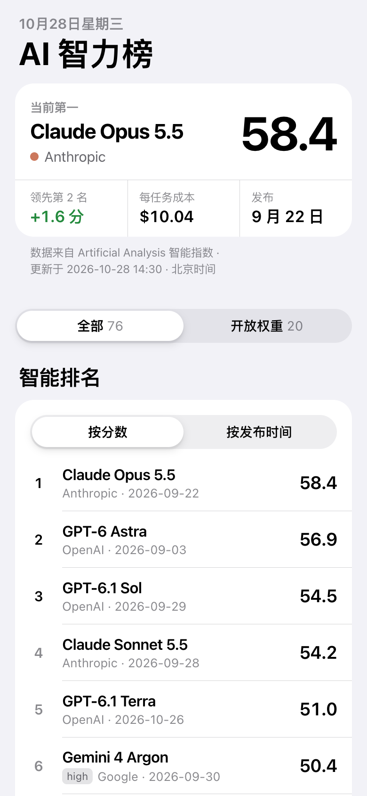
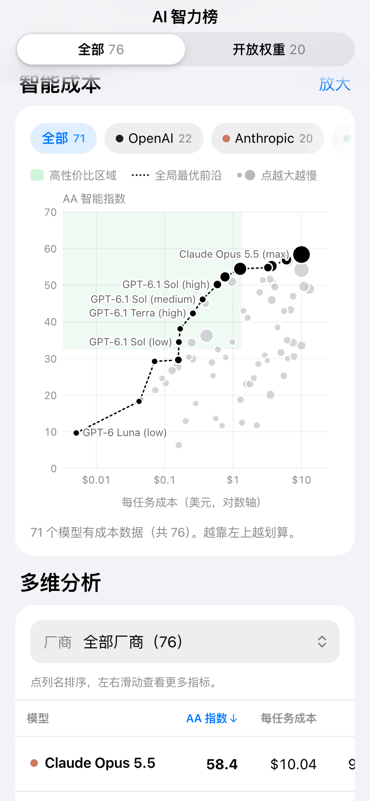
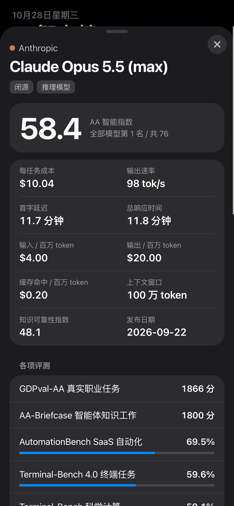

# AI 智力榜

Artificial Analysis 智能指数的中文速览网页，主要给手机看。纯静态页面，放在 GitHub Pages 上，GitHub Actions 每 6 小时自动更新一次数据。

**在线访问：[AI 智力榜 →](https://cupcc.github.io/AI-model-Intelligence/)**

## 页面预览

手机端实际页面截图，支持浅色与深色模式。实时数据请以在线网站为准。

| 智能排名 | 智能成本 | 模型详情 · 深色模式 |
| :---: | :---: | :---: |
|  |  |  |

## 页面内容

- **智能排名**：AA 智能指数前 30 名（同一模型只保留最高分的思考档位），可按发布时间排序
- **智能成本**：智能指数 vs 每任务成本散点图，显示全局最优前沿、高性价比区域，可按厂商筛选、放大
- **多维分析**：可排序表格，包含成本、速度、延迟、价格、上下文、知识可靠性等指标
- 点任意模型可以看详情：各项评测分数（中文名称）、价格、速度等
- “全部模型 / 开放权重”切换，支持深色模式
- **模型筛选与记忆**：搜索模型或厂商、多选要显示的模型，联动排名、成本图和分析表；自动在当前浏览器保存模型选择、范围、厂商和排序，下次打开时恢复，可一键恢复全部
- 界面是 iOS 原生风格（设计稿在 `design/native/`，用 `python3 scripts/ship_design.py` 发布到 `docs/`）

## 目录

```
assets/previews/      README 页面预览图
docs/                 网页（GitHub Pages 发布这个目录）
  index.html
  style.css
  app.js
  data.json           生成的数据，由脚本更新
scripts/build_data.py 抓数据的脚本（只用 Python 标准库）
scripts/ship_design.py 把 design/ 里的方案发布到 docs/
design/               6 套 UI 方案（见 design/README.md）
.github/workflows/    定时更新数据
```

## 数据来源

1. AA 官网榜单页 `artificialanalysis.ai/leaderboards/models` 内嵌的数据：智能指数、开放权重、厂商颜色、每任务成本、速度、各项评测
2. AA 官方 API `/api/v2/data/llms/models`：补发布日期；官网页面抓取失败时，用它刷新分数和价格，其余字段沿用上一次的数据

## 本地运行

```bash
# 在 .env 里写 AA_API_KEY=你的key
python3 scripts/build_data.py              # 生成 docs/data.json
python3 -m http.server 8000 -d docs        # 打开 http://localhost:8000
```

## 部署到 GitHub Pages

1. 在 GitHub 新建仓库，把本目录推上去（`.env` 和 `screenshots/` 已被忽略，不会上传）
2. 仓库 Settings → Secrets and variables → Actions → New repository secret：名字填 `AA_API_KEY`，值填你的 key
3. Settings → Pages → Build and deployment：Source 选 “Deploy from a branch”，Branch 选 `main`，目录选 `/docs`
4. 到 Actions 页面手动运行一次 “更新数据”，确认能成功
5. 仓库首页 About → 设置 → Website 填入部署地址（本仓库为 `https://cupcc.github.io/AI-model-Intelligence/`），方便读者直接访问

数据版权归 [Artificial Analysis](https://artificialanalysis.ai/) 所有，本站为非官方中文整理，页面已注明来源。
